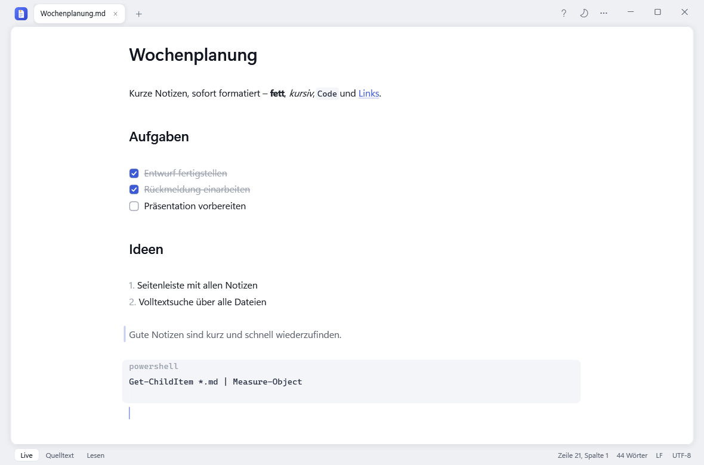
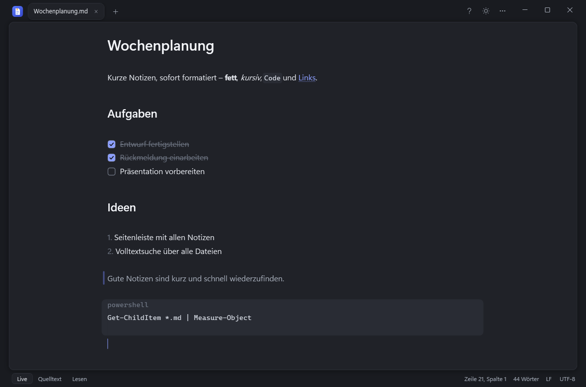
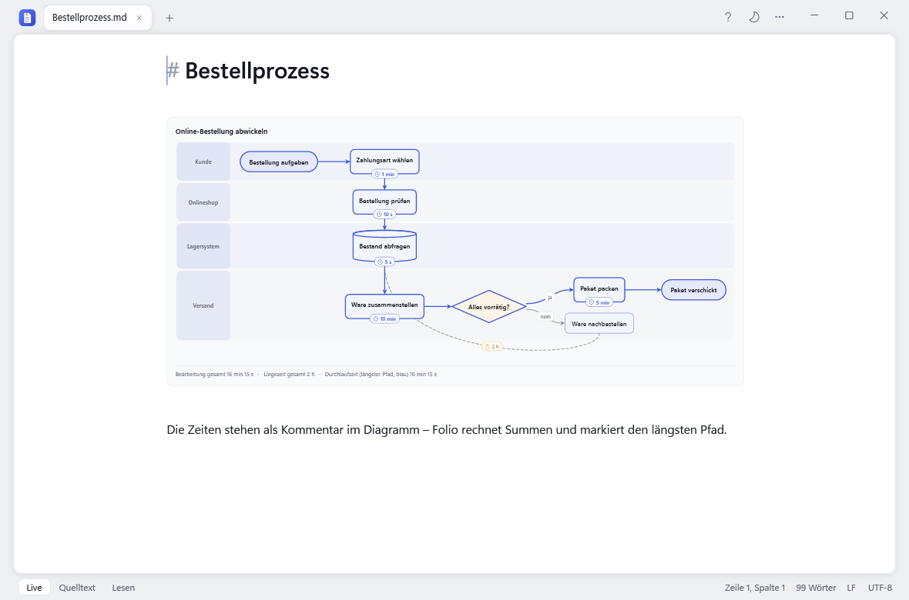
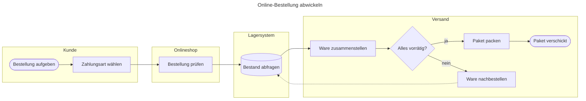
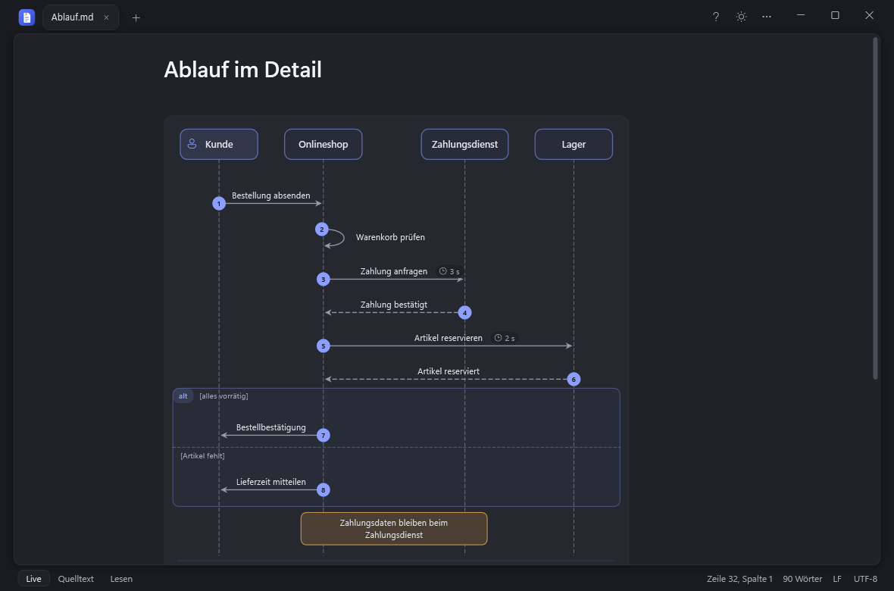
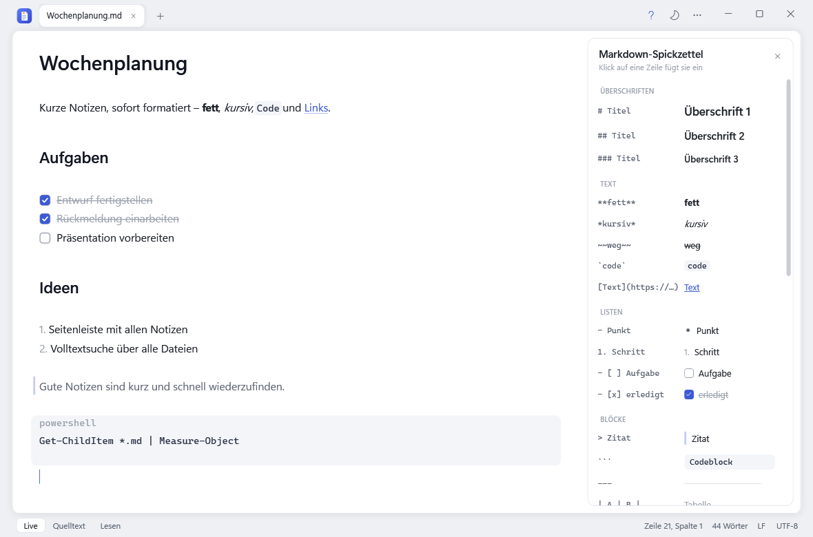

# Folio

Ein nativer Windows-Editor für Notizen und Markdown – schnell wie ein einfacher Texteditor, aber mit
Formatierung beim Tippen, Diagrammen und Prozess-Werkzeugen.



## Funktionen

- **Formatierung beim Tippen**: Überschriften, **fett**, *kursiv*, `Code`, Listen, anklickbare Aufgaben, Zitate,
  Codeblöcke und Links erscheinen sofort formatiert. Die Markdown-Zeichen zeigt Folio nur in der Zeile, in der der
  Cursor steht. Dazu ein Quelltext- und ein Lesemodus.
- **Nichts geht verloren**: Offene Tabs – auch ungespeicherte – sind nach dem Schließen und nach einem Neustart wieder da.
  Neue Notizen landen mit Strg+S in einem festen Notizen-Ordner.
- **Beliebige Textdateien** mit Syntaxfarben und Zeilennummern (`.txt`, `.json`, `.ps1`, …).
- **Markdown-Spickzettel** (F1): was man tippt und wie es aussieht – ein Klick fügt es ein.
- **Diagramme** in ```` ```mermaid ````-Blöcken, nativ gezeichnet:
  Ablaufdiagramme mit Bahnen (`subgraph`), Sequenzdiagramme, Balken- und Tortendiagramme.
- **Prozesszeiten**: `%% zeit B 5 min` (Bearbeitungszeit) und `%% liegezeit A B 2 h` (Wartezeit) – Folio zeigt sie an
  den Schritten, rechnet Summen und hebt den längsten Pfad hervor. Andere Programme ignorieren diese Zeilen.
- **Große Diagramme bleiben lesbar**: Im Text wird nie unter 70 % verkleinert – was nicht passt, lässt sich mit
  Umschalt+Mausrad oder der Leiste darunter verschieben. Der Knopf oben rechts öffnet den **Viewer**: Mausrad zoomt,
  Ziehen verschiebt, Doppelklick wechselt zwischen „Einpassen“ und 100 %.
- **Export als BPMN 2.0** (`.bpmn`) zum Öffnen im Camunda Modeler: Bahnen werden Lanes, Entscheidungen Gateways.
- **Export als Bild**: jedes Diagramm als PNG (doppelte Auflösung) oder SVG (Vektorgrafik) – im Viewer oder über das Menü.
- **Vorlagen**: Prozess-Steckbrief, SIPOC, RACI, Agent-Steckbrief.
- Hell (Standard) und Dunkel, gleitender Cursor und weich einblendende Zeichen (abschaltbar).

## So sieht es aus

### Hell und Dunkel

| Hell | Dunkel |
| --- | --- |
|  |  |

Umschalten über den Mond bzw. die Sonne oben rechts – ohne Neustart.

### Ablaufdiagramm mit Bahnen und Prozesszeiten



Das Diagramm ist ganz normaler Mermaid-Text. Die Zeiten stehen als Kommentar darin – Folio zeigt sie an den Schritten,
rechnet die Summen in der Fußzeile und markiert den längsten Pfad:

````markdown

````

Über das Menü „…“ → „Ablauf als BPMN exportieren“ wird daraus eine `.bpmn`-Datei mit einer Lane pro Bahn.

### Sequenzdiagramm



### Markdown-Spickzettel



Mit F1 oder „?“ oben rechts. Ein Klick auf eine Zeile fügt das Element an der Cursorposition ein –
dort finden sich auch alle Diagramm- und Prozessvorlagen.

## Installation

1. `Folio.exe` aus dem neuesten Release herunterladen.
2. Starten – Folio bietet an, sich zu installieren (nach `%LOCALAPPDATA%\Programs\Folio`, mit Startmenü-Eintrag und
   „Öffnen mit“ für `.md`/`.txt`; ohne Adminrechte, die Standard-App ändert Folio nicht).

Windows zeigt beim ersten Start einer heruntergeladenen Datei eventuell die SmartScreen-Warnung
(„Weitere Informationen“ → „Trotzdem ausführen“), weil die Exe nicht signiert ist.

## Tastenkürzel

| Kürzel | Funktion |
| --- | --- |
| Strg+N / Strg+O / Strg+S | Neue Notiz / Öffnen / Speichern |
| Strg+Umschalt+S | Speichern unter |
| Strg+W / Strg+Umschalt+T | Tab schließen / zuletzt geschlossene Datei |
| Strg+Tab | Nächster Tab |
| Strg+B / Strg+I / Strg+Umschalt+X | Fett / Kursiv / Durchgestrichen |
| Strg+E / Strg+Umschalt+E | Lesemodus / Quelltextmodus |
| Strg+F | Suchen |
| F1 | Markdown-Spickzettel |
| Strg+Mausrad, Strg+0 | Zoom |

Verwendet [AvalonEdit](https://github.com/icsharpcode/AvalonEdit) und [Markdig](https://github.com/xoofx/markdig).

## Lizenz

[MIT](LICENSE)
